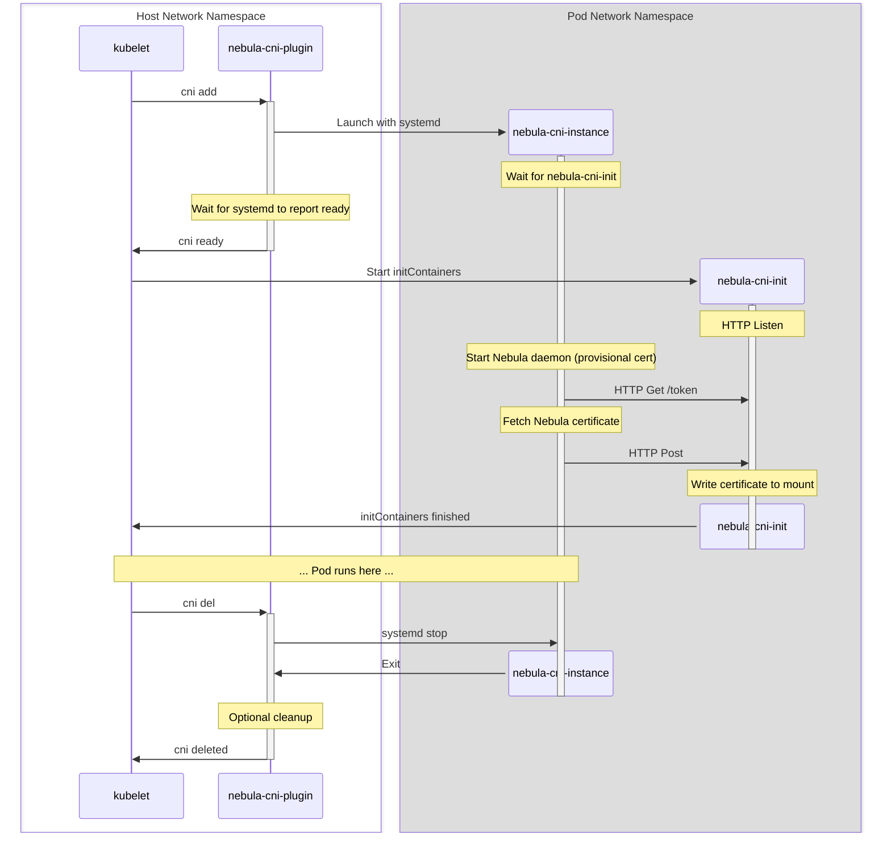

> [!CAUTION]
> This repository is still in development and should be considered **experimental**
> until there is a v1.0.0 release.

nebula-cni
==========

This is a [CNI](https://github.com/containernetworking/cni/blob/main/SPEC.md)
that:

- Fetches a Nebula certificate
- Starts Nebula
- Optionally changes the Pod IP to be the Nebula IP

Design
------

Things get a little complicated because of a few compounding facts:

- CNI plugins are run as a single-shot binary for each Pod creation / deletion.
  It is not a long lived service.
- At the time that nebula-cni gets run, the IP address was just picked by the
  aws-vpc-cni and thus hasn't been recorded to the Kube API yet. This means we
  don't really have a source of truth on if we should trust this pod to get a
  Nebula cert for that IP. We could describe-network-interfaces to see if the
  IP is attached to that instance, but AWS like to rate limit calls like this.
- One way we can verify ownership of the IP address is having the nebula-ca
  request come from the network namespace. But it looks like network traffic
  in the namespace doesn't work until the CNI plugins all return and something
  else happens inside of the kubelet (maybe network policies?).

Due to these facts, we have designed Nebula CNI with three components:

- `nebula-cni-plugin` is the CNI plugin placed in the CNI config, called when all new pods are created/destroyed. It is not a long lived daemon, it is a one-shot executable that is run once per CNI command (and must exit for the CNI chain to finish).
- `nebula-cni-instance` is a process we spawn that will run directly on the host, but inside of the network namespace for the pod. This is basically nebula with some helper code wrapped around it.
- `nebula-cni-init` is an initContainer that we will inject into all pods that use Nebula CNI. This is so we can have the pod wait until the CNI is ready to continue, and also a way to get the certificate into the pod.

Here is a diagram of the interactions:

Usage
-----

First, build `nebula-cni-install.Dockerfile` and patch this as an init container to
your main CNI daemonset (Cilium, amazon-vpc-cni-k8s, ...). This container installs
the binaries to the host needed for the CNI plugin. Example for Cilium:

    extraInitContainers:
      - image: "__IMAGE_NEBULA_CNI_INSTALL__"
        imagePullPolicy: Always
        name: nebula-cni-install
        volumeMounts:
          - mountPath: /host/opt/cni/bin
            name: cni-path

Next add `nebula-cni-plugin` as the final plugin in your CNI plugins list. Usually you
would do this by modifying the config of your primary CNI deployment. For example,
you can set the following for Cilium:

    cni-config: |-
      {
        "cniVersion": "0.3.1",
        "name": "cilium-cni",
        "disableCheck": true,
        "plugins": [
          {
            "cniVersion":"0.3.1",
            "type":"cilium-cni"
          },
          {
            "type": "nebula-cni-plugin",
            "kubeconfig": "/etc/kube/config"
          }
        ]
      }

Next, the `nebula-cni-install.Dockerfile` container needs to be injected as
the first initContainer of every pod deployment. You can do this with an
admission controller.

    initContainers:
      - env:
        - name: POD_IP
          valueFrom:
            fieldRef:
              apiVersion: v1
              fieldPath: status.podIP
        image: "__IMAGE_NEBULA_CNI_INIT__"
        imagePullPolicy: IfNotPresent
        name: nebula-cni-init
        volumeMounts:
        - mountPath: /nebula
          name: nebula
        - mountPath: /var/run/secrets/nebula-cni/serviceaccount
          name: service-account-token-nebula-cni
          readOnly: true

Future Work
-----------

- Move some of the `nebula-cni-plugin` logic into a DaemonSet that can be longer lived. We started work on that but
  found the effort wasn't worth the reward at the time. Future features might mean that having a long lived service is
  better (we don't want to store state there though since that will make redeployments of the DaemonSet difficult).
- Remove the need for an init container. We had a few requirements when initially developing this CNI that required the use of
  an init container, but these might be able to be reworked. Currently we use the init container to fetch the service account token
  of the pod, but this could instead be done by a DaemonSet on the host similar to how CSI implementations do it (they have permission to
  impersonate other deployments and create service accounts tokens for them). We also ran into issues with networking in the pod not
  working until the CNI plugin itself finished, which made having an init container nice because at that point networking was working
  in the pod 's namespace. This might be able to be resolved a different way.
